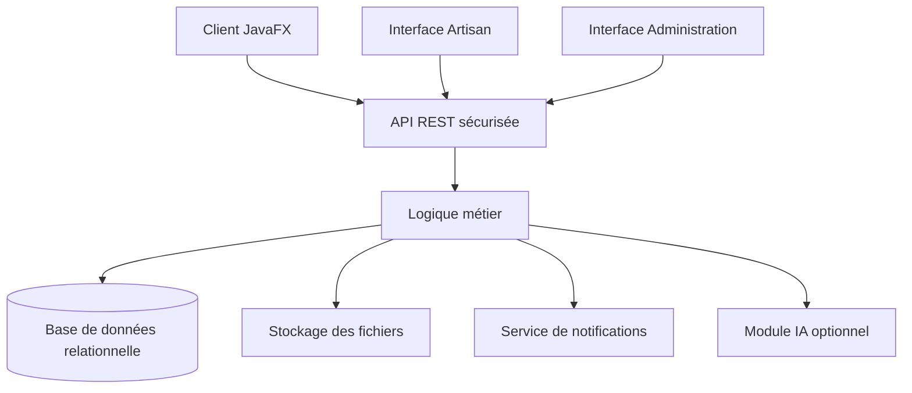

# Fixi — Application de mise en relation entre clients et artisans

> **Trouver le bon artisan. Comprendre le prix. Suivre chaque intervention.**
>
> Fixi est une application de bureau conçue pour faciliter la mise en relation entre les clients et les artisans au Maroc, tout en améliorant la transparence des devis, le suivi des interventions et l'historique des réparations.

<p align="center">

**Projet académique — Programmation Orientée Objet Avancée (Java)**

</p>

---

## Table des matières

- [1. Présentation du projet](#1-présentation-du-projet)
- [2. Contexte et problématique](#2-contexte-et-problématique)
- [3. Vision du produit](#3-vision-du-produit)
- [4. Analyse QQQOCP](#4-analyse-qqqocp)
- [5. Objectifs du projet](#5-objectifs-du-projet)
- [6. Utilisateurs et rôles](#6-utilisateurs-et-rôles)
- [7. Périmètre fonctionnel](#7-périmètre-fonctionnel)
- [8. Parcours utilisateur](#8-parcours-utilisateur)
- [9. Exigences non fonctionnelles](#9-exigences-non-fonctionnelles)
- [10. Architecture technique](#10-architecture-technique)
- [11. Conception orientée objet](#11-conception-orientée-objet)
- [12. Modèle de données](#12-modèle-de-données)
- [13. Technologies et outils](#13-technologies-et-outils)
- [14. Structure du projet](#14-structure-du-projet)
- [15. Installation et lancement](#15-installation-et-lancement)
- [16. Tests et qualité du code](#16-tests-et-qualité-du-code)
- [17. Organisation de l'équipe](#17-organisation-de-léquipe)
- [18. Méthodologie et feuille de route](#18-méthodologie-et-feuille-de-route)
- [19. Livrables académiques](#19-livrables-académiques)
- [20. Sécurité et protection des données](#20-sécurité-et-protection-des-données)
- [21. Améliorations envisagées](#21-améliorations-envisagées)
- [22. Critères de réussite](#22-critères-de-réussite)
- [23. Contribution au projet](#23-contribution-au-projet)
- [24. État d'avancement](#24-état-davancement)
- [25. Équipe et contact](#25-équipe-et-contact)

---

## 1. Présentation du projet

**Fixi** est un projet d'application de bureau visant à moderniser la recherche de professionnels et la gestion des travaux de réparation au Maroc.

L'application permettra aux particuliers et aux syndics de rechercher des artisans selon leur métier et leur zone géographique, de publier des demandes de service, de recevoir des devis détaillés et de suivre les interventions jusqu'à leur clôture.

Elle proposera également un espace dédié aux artisans pour gérer leurs demandes, leurs devis et leurs interventions, ainsi qu'un espace d'administration destiné à superviser la plateforme.

À terme, Fixi ambitionne d'intégrer des fonctionnalités d'intelligence artificielle afin d'aider les utilisateurs à formuler leurs demandes, d'estimer les prix indicatifs et de détecter les devis présentant des écarts importants.

### Informations générales

| Élément | Description |
|---|---|
| Nom du projet | Fixi |
| Type | Application de bureau (desktop) |
| Domaine | Services, réparation et mise en relation |
| Public cible | Clients, artisans et administrateurs |
| Zone géographique visée | Maroc |
| Langage principal | Java |
| Paradigme | Programmation orientée objet |
| Interface graphique envisagée | JavaFX |
| Gestion des dépendances | Maven |
| Gestion de versions | Git et GitHub |
| Base de données | Solution relationnelle à définir |
| Architecture cible | Application desktop connectée à un serveur central |
| Devise | Dirham marocain (MAD) |
| Langues prévues | Français et arabe |

*Remarque : les technologies proposées constituent une base de travail. Les choix définitifs doivent être validés par l'équipe avant l'implémentation.*

## 2. Contexte et problématique

### 2.1. Contexte

Au Maroc, la recherche d'un artisan repose souvent sur les recommandations personnelles, les réseaux sociaux ou les contacts directs.

Bien que ces méthodes soient utiles, elles ne garantissent pas toujours la transparence des prix, la disponibilité des professionnels, la traçabilité des travaux ou la conservation d'un historique des réparations.

Les clients peuvent rencontrer des difficultés pour comparer les offres et suivre leurs interventions. De leur côté, les artisans peuvent manquer d'outils simples pour organiser leurs demandes, leurs rendez-vous et leur facturation.

### 2.2. Problématique

**Comment concevoir une application de bureau simple, fiable et ergonomique permettant aux clients de trouver des artisans adaptés à leurs besoins, de comparer des devis transparents et de suivre leurs interventions, tout en facilitant la gestion quotidienne des professionnels ?**

### 2.3. Solution proposée

Fixi centralise les principales étapes du parcours :

- Recherche de professionnels par métier et localisation.
- Publication et gestion des demandes de service.
- Réception et comparaison des devis.
- Acceptation d'un devis et planification des travaux.
- Suivi des interventions et conservation des preuves.
- Consultation de l'historique des réparations.
- Évaluation des prestations après leur clôture.

L'objectif est de créer un environnement numérique favorisant la transparence, l'organisation et la confiance entre les clients et les artisans.

## 3. Vision du produit

### 3.1. Vision

Faire de Fixi une solution accessible qui simplifie la recherche d'artisans et rend les services de réparation plus transparents, traçables et faciles à gérer au Maroc.

### 3.2. Proposition de valeur

- **Pour les clients :** trouver des professionnels, comparer les devis et conserver un historique des interventions.
- **Pour les artisans :** centraliser les demandes, structurer les devis et mieux organiser les travaux.
- **Pour les administrateurs :** superviser les profils, gérer les signalements et suivre les indicateurs de la plateforme.

### 3.3. Différenciation

Fixi ne se limite pas à un annuaire de professionnels. Sa valeur ajoutée repose sur la continuité du service : de la demande initiale au devis, puis à l'intervention, à la facturation et à l'évaluation.

L'historique des réparations et les devis détaillés constituent des axes importants de différenciation.

## 4. Analyse QQQOCP

| Question | Analyse |
|---|---|
| **Qui ?** | Les particuliers, les syndics, les artisans, les petites entreprises et les administrateurs de Fixi. |
| **Quoi ?** | Une application permettant de rechercher des artisans, de gérer des demandes, de comparer des devis et de suivre les réparations. |
| **Quand ?** | Lorsqu'un utilisateur souhaite effectuer une réparation, demander un service, planifier des travaux ou consulter un historique. |
| **Où ?** | Dans le contexte des services de proximité au Maroc, à travers une application de bureau connectée à un serveur central. |
| **Comment ?** | Par une interface graphique, des profils, des filtres de recherche, des demandes, des devis structurés, une messagerie et un suivi des interventions. |
| **Pourquoi ?** | Pour réduire la difficulté de recherche, améliorer la transparence des prix, structurer les échanges et conserver une trace des travaux réalisés. |

## 5. Objectifs du projet

### 5.1. Objectif général

Concevoir et développer une application de bureau en Java, fondée sur les principes de la programmation orientée objet, permettant de mettre en relation clients et artisans et de gérer le cycle de vie d'une intervention.

### 5.2. Objectifs fonctionnels

- Gérer les comptes et les profils.
- Rechercher des artisans selon plusieurs critères.
- Créer, consulter et gérer des demandes de service.
- Émettre, modifier, comparer, accepter ou refuser des devis.
- Planifier et suivre les interventions.
- Conserver l'historique des réparations.
- Gérer les avis et les évaluations.
- Fournir des tableaux de bord et des statistiques.
- Permettre l'administration des données et des utilisateurs.

### 5.3. Objectifs pédagogiques

Le développement de Fixi permettra de mettre en pratique :

- Les classes, objets, attributs et méthodes.
- L'encapsulation, l'héritage, le polymorphisme et l'abstraction.
- Les interfaces et les classes abstraites.
- Les collections et les génériques.
- La gestion des exceptions.
- Les entrées/sorties et la persistance des données.
- La création d'interfaces graphiques avec JavaFX.
- L'accès à une base de données relationnelle.
- Les tests unitaires et les tests d'intégration.
- Les patrons de conception adaptés au besoin.
- La gestion de projet avec Maven, Git et GitHub.
- La documentation et la conteneurisation avec Docker.

## 6. Utilisateurs et rôles

### 6.1. Client

Le client est une personne physique ou un représentant de syndic qui souhaite obtenir un service.

**Responsabilités et fonctionnalités :**

- Créer et gérer son compte.
- Rechercher des artisans par métier et ville.
- Consulter les profils et les disponibilités.
- Publier une demande avec une description et, si nécessaire, des photos.
- Recevoir et comparer plusieurs devis.
- Accepter ou refuser un devis.
- Échanger avec l'artisan.
- Suivre l'avancement de l'intervention.
- Consulter l'historique des réparations.
- Évaluer une intervention clôturée.

### 6.2. Artisan

L'artisan est un professionnel indépendant ou une petite entreprise proposant des services.

**Responsabilités et fonctionnalités :**

- Créer et compléter son profil professionnel.
- Déclarer ses métiers et ses zones d'intervention.
- Consulter les demandes qui lui sont adressées.
- Préparer et envoyer des devis détaillés.
- Réviser les devis selon les règles prévues.
- Gérer les rendez-vous et les interventions.
- Ajouter des notes et des photos de travaux.
- Émettre des factures.
- Consulter ses évaluations et répondre aux avis.

### 6.3. Administrateur

L'administrateur assure la supervision de la plateforme.

**Responsabilités et fonctionnalités :**

- Gérer les comptes et les rôles.
- Vérifier, valider ou suspendre les profils d'artisans.
- Gérer les catégories de métiers et les villes.
- Modérer les avis et les signalements.
- Consulter et traiter les litiges.
- Consulter les tableaux de bord.
- Exporter les données autorisées.
- Consulter les journaux d'audit.

**Principe de sécurité :** chaque rôle ne doit accéder qu'aux fonctionnalités et aux données autorisées.

## 7. Périmètre fonctionnel

Pour rendre le projet réalisable dans le cadre académique, les fonctionnalités sont réparties en trois niveaux.

### 7.1. Version initiale — fonctionnalités essentielles

| Module | Fonctionnalités |
|---|---|
| Authentification | Connexion, déconnexion et gestion des rôles |
| Profils | Création, consultation, modification et suppression autorisée |
| Artisans | Gestion du métier, de la ville, de la description et des tarifs indicatifs |
| Recherche | Recherche par métier et ville, avec filtres complémentaires |
| Demandes | Création, consultation, modification et gestion du statut |
| Devis | Création, consultation, comparaison, acceptation et refus |
| Interventions | Planification et mise à jour des statuts |
| Historique | Consultation des interventions terminées |
| Avis | Notation et commentaire après clôture |
| Tableau de bord | Statistiques de base et historiques |
| Persistance | Enregistrement et récupération des données dans une base relationnelle |

### 7.2. Fonctionnalités complémentaires

- Recherche par disponibilité et distance.
- Messagerie entre client et artisan.
- Gestion de l'agenda.
- Génération de factures PDF.
- Export de l'historique.
- Notifications de changement de statut.
- Gestion des litiges.
- Gestion des pièces jointes.

### 7.3. Fonctionnalités avancées

- Assistant intelligent pour structurer les demandes.
- Estimation indicative des prix par métier et par ville.
- Détection des devis présentant des écarts importants.
- Recommandation d'artisans.
- Paiement en ligne.
- Notifications par SMS.
- Mode hors ligne avec synchronisation.
- Interface bilingue français-arabe.

Ces fonctionnalités avancées ne doivent être entreprises qu'après validation du socle fonctionnel.

## 8. Parcours utilisateur

### 8.1. Parcours principal du client

1. Le client se connecte à Fixi.
2. Il recherche un artisan ou publie une demande de service.
3. Un ou plusieurs artisans reçoivent la demande.
4. Les artisans intéressés transmettent leurs devis.
5. Le client compare les montants, les prestations et les délais.
6. Il accepte un devis.
7. Une intervention est planifiée.
8. L'artisan réalise les travaux et documente l'intervention.
9. Le client valide la réalisation.
10. L'intervention est clôturée et le client peut déposer un avis.
11. Les informations sont conservées dans l'historique.

### 8.2. Cycle de vie d'une intervention

Le cycle de vie prévu est le suivant :

`Demande envoyée → Devis reçu → Devis accepté → Intervention planifiée → En cours → Terminée par l'artisan → Validée par le client → Clôturée et évaluée`

Des états alternatifs doivent également être pris en compte : demande expirée, devis refusé, intervention annulée et litige ouvert.

Les transitions entre les états doivent être contrôlées par la logique métier. Un utilisateur ne doit pas pouvoir clôturer une intervention dans des conditions non autorisées.

## 9. Exigences non fonctionnelles

### 9.1. Performance

- Temps d'ouverture visé : moins de 5 secondes.
- Temps de recherche d'artisans visé : moins de 2 secondes.

Ces objectifs devront être vérifiés par des tests dans un environnement défini.

### 9.2. Sécurité

- Authentification des utilisateurs.
- Gestion des droits par rôle.
- Hachage sécurisé des mots de passe.
- Protection des communications avec le serveur.
- Validation des données reçues.
- Journalisation des opérations sensibles.
- Protection des pièces jointes et des documents confidentiels.

### 9.3. Ergonomie

- Interface claire et cohérente.
- Navigation intuitive.
- Formulaires compréhensibles.
- Messages d'erreur explicites.
- Utilisation adaptée aux personnes peu familières du numérique.
- Prise en charge prévue du français et de l'arabe.

### 9.4. Maintenabilité

- Code modulaire et documenté.
- Séparation des responsabilités.
- Tests automatisés.
- Gestion centralisée des dépendances.
- Utilisation de conventions de nommage cohérentes.
- Versionnement du code et des documents.

### 9.5. Disponibilité et synchronisation

L'architecture cible prévoit un serveur central. Un éventuel mode hors ligne devra préciser les fonctionnalités accessibles localement et les règles de synchronisation au retour de la connexion.

## 10. Architecture technique

### 10.1. Architecture cible

Fixi est envisagé comme un client lourd Java qui communique avec un serveur central via une API REST sécurisée.



Les interfaces des différents rôles peuvent partager une même application desktop, avec des écrans et des permissions adaptés au rôle connecté.

### 10.2. Responsabilités des couches

| Couche | Responsabilité |
|---|---|
| Présentation | Affichage JavaFX, navigation, formulaires et interactions |
| Application | Coordination des cas d'utilisation |
| Métier | Entités, règles métier, validations et transitions de statut |
| Persistance | Accès à la base de données |
| Communication | Échanges avec l'API REST |
| Services externes | Notifications, stockage de fichiers et fonctionnalités IA |

### 10.3. Architecture adaptée au mini-projet

Le choix entre une application directement connectée à la base de données et une architecture client-serveur complète devra être validé dès la conception.

L'architecture client-serveur correspond à la vision cible du cahier des charges, mais elle implique de développer et de déployer un backend en plus de l'application JavaFX.

Si les contraintes de temps ne permettent pas de réaliser l'ensemble, l'équipe pourra commencer par une version desktop avec une couche de persistance isolée, tout en documentant clairement les limites de cette première version.

## 11. Conception orientée objet

La conception doit privilégier des objets représentant les concepts réels du domaine et des classes dont les responsabilités sont clairement définies.

### 11.1. Entités métier principales

- `Utilisateur`
- `Client`
- `Artisan`
- `Administrateur`
- `ProfilArtisan`
- `Demande`
- `Devis`
- `LigneDevis`
- `Intervention`
- `Avis`
- `Message`
- `Facture`
- `Paiement`
- `Litige`
- `Logement`
- `Equipement`

### 11.2. Services applicatifs envisagés

- `AuthentificationService`
- `UtilisateurService`
- `ArtisanService`
- `RechercheService`
- `DemandeService`
- `DevisService`
- `InterventionService`
- `AvisService`
- `FacturationService`
- `StatistiquesService`

### 11.3. Principes de conception

**Encapsulation :** les attributs sont protégés et leur modification passe par des méthodes contrôlées.

**Abstraction :** les concepts communs sont factorisés lorsque cela est pertinent.

**Héritage :** une hiérarchie peut être utilisée pour les types d'utilisateurs si leurs comportements communs le justifient.

**Polymorphisme :** les comportements peuvent varier selon le type d'utilisateur ou le service utilisé.

**Séparation des responsabilités :** les contrôleurs graphiques ne doivent pas contenir toute la logique métier ni les requêtes SQL.

**Faible couplage :** les composants doivent dépendre d'interfaces lorsque cela facilite les tests et l'évolution.

### 11.4. Patrons de conception envisageables

- **MVC :** séparation entre modèle, interface et contrôleur.
- **Repository :** abstraction des opérations de persistance.
- **Service Layer :** centralisation des cas d'utilisation et des règles applicatives.
- **Factory :** création contrôlée d'objets lorsque plusieurs variantes existent.
- **Strategy :** variation des méthodes de recherche ou de recommandation.
- **Observer :** propagation d'événements dans les composants concernés.

Ces patrons seront adoptés uniquement lorsqu'ils apportent une réelle valeur au projet.

## 12. Modèle de données

Le modèle relationnel devra préserver la cohérence des données, éviter les duplications inutiles et assurer l'intégrité des relations.

| Entité | Informations principales |
|---|---|
| Utilisateur | Identifiant, nom, e-mail, téléphone, rôle, statut |
| ProfilArtisan | Utilisateur associé, métiers, zones, documents, note moyenne |
| Categorie | Identifiant, nom, description |
| Demande | Client, catégorie, description, adresse, urgence, statut |
| DemandeArtisan | Demande, artisan destinataire, état de traitement |
| Devis | Demande, artisan, version, total, TVA, validité, statut |
| LigneDevis | Devis, désignation, quantité, prix unitaire |
| Intervention | Devis accepté, planning, statut, dates |
| Logement | Propriétaire, adresse, informations générales |
| Equipement | Logement, type, marque, date d'installation |
| HistoriqueReparation | Intervention, équipement, coût, travaux, garantie |
| Message | Demande, expéditeur, contenu, date |
| Facture | Intervention, numéro, montant, date, statut |
| Paiement | Facture ou intervention, montant, mode, date, statut |
| Avis | Intervention, auteur, note, commentaire |
| Litige | Intervention, motif, preuves, décision |

Les relations exactes, les cardinalités, les clés étrangères et les contraintes devront être définies dans le diagramme de classes et le modèle relationnel.

**Règles de cohérence à prévoir :**

- Une demande appartient à un client.
- Un devis est associé à une demande et à un artisan.
- Une intervention découle d'un devis accepté.
- Un avis ne peut être publié qu'après la clôture d'une intervention.
- Une facture doit être associée à une intervention identifiable.
- Les opérations sensibles doivent vérifier les droits de l'utilisateur.

## 13. Technologies et outils

Les technologies ci-dessous constituent une proposition initiale.

| Technologie ou outil | Utilisation prévue |
|---|---|
| Java 21 ou version compatible validée | Développement principal |
| JavaFX | Interface graphique |
| Maven | Dépendances, compilation et tests |
| PostgreSQL | Base de données relationnelle cible |
| JDBC ou solution d'accès aux données validée | Communication avec la base |
| Git | Gestion des versions |
| GitHub | Dépôt, issues, pull requests et suivi |
| JUnit 5 | Tests unitaires |
| Mockito | Simulation des dépendances dans les tests |
| Scene Builder | Conception visuelle des interfaces JavaFX |
| Figma | Maquettes et prototypes |
| PlantUML ou Mermaid | Documentation des diagrammes |
| Docker | Conteneurisation des services compatibles |
| GitHub Actions | Automatisation possible de la compilation et des tests |

Le choix de PostgreSQL et l'ajout d'un backend ne sont pas des obligations déjà confirmées : ils devront être arrêtés collectivement en fonction de l'architecture retenue.

## 14. Structure du projet

La structure suivante est une proposition de départ pour un dépôt organisé et maintenable.

```text
fixi/
├── README.md
├── pom.xml
├── .gitignore
├── .env.example
├── LICENSE
│
├── docs/
│   ├── cahier-des-charges.md
│   ├── product-vision.md
│   ├── exigences.md
│   ├── architecture.md
│   ├── conception/
│   │   ├── diagramme-classes.puml
│   │   ├── diagramme-cas-utilisation.puml
│   │   └── modele-donnees.md
│   ├── maquettes/
│   ├── tests/
│   └── rapport/
│
├── src/
│   ├── main/
│   │   ├── java/
│   │   │   └── ma/fixi/
│   │   │       ├── Main.java
│   │   │       ├── config/
│   │   │       ├── model/
│   │   │       ├── repository/
│   │   │       ├── service/
│   │   │       ├── controller/
│   │   │       ├── view/
│   │   │       ├── dto/
│   │   │       ├── exception/
│   │   │       └── util/
│   │   └── resources/
│   │       ├── fxml/
│   │       ├── css/
│   │       ├── images/
│   │       └── db/
│   │           └── migrations/
│   │
│   └── test/
│       └── java/
│           └── ma/fixi/
│
├── docker/
│   └── README.md
│
└── .github/
    ├── ISSUE_TEMPLATE/
    └── workflows/
```

Cette arborescence sera adaptée à la solution réellement retenue. Si un backend séparé est développé, il pourra disposer de son propre module Maven.

Les fichiers sensibles, les mots de passe, les clés d'API et les données personnelles réelles ne doivent jamais être versionnés dans Git.

## 15. Installation et lancement

### 15.1. Prérequis

Avant de lancer le projet, prévoir :

- Un JDK compatible avec la version Java retenue.
- Apache Maven.
- Git.
- Un IDE compatible, par exemple IntelliJ IDEA, Eclipse ou Visual Studio Code avec les extensions appropriées.
- Une base de données configurée, lorsque la persistance sera intégrée.

### 15.2. Cloner le dépôt

```bash
git clone <URL_DU_DEPOT_GITHUB>
cd fixi
```

Remplacer `<URL_DU_DEPOT_GITHUB>` par l'adresse réelle du dépôt.

### 15.3. Compiler et tester

```bash
mvn clean test
```

### 15.4. Compiler le projet

```bash
mvn clean package
```

### 15.5. Lancer l'application

La commande exacte dépendra de la configuration JavaFX et du point d'entrée déclarés dans le `pom.xml`.

Une fois cette configuration mise en place, la commande de lancement sera documentée ici.

**Important :** ces commandes constituent le parcours Maven prévu. Elles ne garantissent pas un lancement immédiat tant que le projet, ses dépendances, sa configuration JavaFX et sa base de données n'ont pas été implémentés.

## 16. Tests et qualité du code

Les tests doivent accompagner le développement et être exécutés à la fin de chaque itération.

### 16.1. Tests unitaires

Les premiers tests porteront notamment sur :

- La validation des données utilisateur.
- Les règles de création et de modification d'une demande.
- Le calcul des lignes de devis et du montant total.
- Le calcul de la TVA selon les paramètres retenus.
- Les changements autorisés de statut.
- Les règles d'acceptation et de refus d'un devis.
- Les restrictions de publication des avis.
- Les permissions selon le rôle.

### 16.2. Tests d'intégration

- Enregistrement et récupération des données.
- Intégrité des relations entre les entités.
- Vérification des transactions.
- Gestion des erreurs de persistance.
- Contrôle des accès aux services.

### 16.3. Tests de bout en bout

Le scénario principal à valider est :

`Connexion → Demande → Devis → Acceptation → Intervention → Clôture → Avis`

### 16.4. Qualité attendue

- Code lisible et cohérent.
- Méthodes de taille raisonnable.
- Gestion explicite des erreurs.
- Absence de duplication injustifiée.
- Tests des règles métier essentielles.
- Documentation des choix techniques.
- Compilation et tests vérifiés avant chaque fusion.

## 17. Organisation de l'équipe

Le projet doit être réalisé par une équipe de cinq à six étudiants au maximum, conformément aux consignes du module.

### 17.1. Rôles proposés

| Rôle | Responsabilités |
|---|---|
| Chef de projet | Coordination, suivi des tâches, calendrier et GitHub |
| Responsable conception | UML, architecture et cohérence des modèles |
| Responsable interface | Maquettes, ergonomie et JavaFX |
| Responsable logique métier | Entités, services et règles de gestion |
| Responsable données et tests | Persistance, scénarios de test et qualité |
| Responsable documentation et intégration | README, rapports, intégration et préparation des livrables |

Dans une équipe de cinq personnes, certains rôles pourront être regroupés. La répartition réelle devra être adaptée aux compétences et à la disponibilité des membres.

### 17.2. Règles GitHub

- Une branche principale stable.
- Une branche de développement si elle est nécessaire à l'organisation de l'équipe.
- Une branche par fonctionnalité ou correction.
- Des commits courts et explicites.
- Des pull requests avant intégration.
- Une revue du code par un autre membre lorsque cela est possible.
- Des issues pour suivre les tâches et les anomalies.
- Des jalons correspondant aux itérations de quinze jours.

### 17.3. Convention de nommage des branches

```text
feature/authentification
feature/recherche-artisans
feature/gestion-demandes
feature/gestion-devis
feature/suivi-interventions
fix/calcul-total-devis
docs/diagramme-classes
test/intervention-service
```

### 17.4. Convention des commits

Exemples :

```text
feat: ajouter la recherche par métier
feat: créer le modèle de demande
fix: corriger le calcul du total du devis
test: ajouter les tests du service devis
docs: documenter l'architecture
refactor: séparer la logique métier du contrôleur
```

Les commits doivent décrire une modification réelle et ne doivent pas regrouper des changements sans rapport.

## 18. Méthodologie et feuille de route

Le projet sera réalisé selon une démarche itérative, avec des cycles de quinze jours, des objectifs définis et des tests en fin d'itération.

### Semaine 1 — Cadrage du projet

**Objectif :** définir précisément le besoin et la vision du produit.

Travaux :

- Constituer l'équipe et désigner le chef de projet.
- Créer le dépôt GitHub.
- Choisir et formuler la problématique.
- Compléter l'analyse QQQOCP.
- Rédiger la Product Vision.
- Définir les premières responsabilités.

Livrables :

- Fiche de groupe.
- Problématique documentée.
- Analyse QQQOCP.
- Product Vision.

### Première itération — Conception (15 jours)

**Objectif :** préparer une conception suffisamment claire pour commencer le développement.

Travaux :

- Identifier les exigences fonctionnelles et non fonctionnelles.
- Rédiger le cahier des charges.
- Concevoir les maquettes.
- Élaborer le diagramme de classes.
- Réaliser le diagramme de cas d'utilisation.
- Définir l'architecture technique.
- Préparer le modèle de données.
- Définir les premiers cas de test.

Livrables :

- Document des exigences.
- Diagramme de classes détaillé.
- Diagramme de cas d'utilisation.
- Maquettes de l'interface.
- Documentation de l'architecture.
- Synthèse des choix de conception.

### Itération suivante — Socle technique

**Objectif :** établir une base exécutable et testable.

Travaux envisagés :

- Configurer Maven et JavaFX.
- Créer la structure du code.
- Définir les premières entités.
- Mettre en place la persistance.
- Développer la navigation principale.
- Mettre en place les premiers tests automatisés.

### Itérations de développement

**Objectif :** intégrer progressivement les fonctionnalités prioritaires.

Ordre de développement proposé :

1. Authentification et gestion des rôles.
2. Profils et recherche d'artisans.
3. Demandes de service.
4. Devis et comparaison.
5. Suivi des interventions.
6. Historique et avis.
7. Tableau de bord.
8. Fonctionnalités complémentaires.

Chaque itération doit se terminer par une revue des fonctionnalités, l'exécution des tests et la mise à jour de la documentation.

### Phase finale — Validation et présentation

Travaux :

- Corriger les anomalies restantes.
- Vérifier les parcours complets.
- Finaliser les diagrammes et les maquettes.
- Préparer le rapport et la présentation.
- Préparer la démonstration.
- Documenter le déploiement et, si retenu, Docker.

## 19. Livrables académiques

### Livrables collectifs

- [ ] Fiche du groupe et répartition des rôles.
- [ ] Lien du dépôt GitHub.
- [ ] Document de problématique et Product Vision.
- [ ] Cahier des charges.
- [ ] Exigences fonctionnelles et non fonctionnelles.
- [ ] Diagramme de classes détaillé.
- [ ] Diagramme de cas d'utilisation.
- [ ] Maquettes des interfaces.
- [ ] Code source commenté et organisé.
- [ ] Tests unitaires et, lorsque possible, tests d'intégration.
- [ ] Rapport de réalisation.
- [ ] Présentation PowerPoint.
- [ ] Documentation technique.
- [ ] Élément de démonstration ou de déploiement Docker, selon les attentes du module.

### Livrable individuel

Chaque étudiant doit produire un rapport personnel présentant les apprentissages réalisés, les contributions apportées, les difficultés rencontrées et les compétences acquises.

## 20. Sécurité et protection des données

Fixi est destiné à traiter des données relatives aux utilisateurs, aux demandes, aux adresses, aux documents et aux interventions. La sécurité doit donc être prise en compte dès la conception.

Principes à respecter :

- Ne jamais stocker les mots de passe en clair.
- Limiter les accès selon le rôle et les droits.
- Vérifier les données avant leur enregistrement.
- Protéger les communications avec le serveur.
- Ne pas exposer les informations privées dans les journaux.
- Sécuriser les documents transmis et les pièces jointes.
- Prévoir des règles de conservation et de suppression des données.
- Documenter les traitements de données personnelles.

Le projet devra également étudier les obligations applicables au Maroc, notamment la loi 09-08 et les exigences de la CNDP, en fonction des traitements réellement mis en œuvre.

## 21. Améliorations envisagées

Les fonctionnalités suivantes pourront enrichir le projet si le socle principal est stable.

### 21.1. Assistant intelligent

L'assistant pourra transformer une description libre en demande structurée, proposer des questions complémentaires et suggérer une catégorie de service.

### 21.2. Estimation indicative des prix

Le système pourra calculer une fourchette indicative à partir de données de référence disponibles, selon le métier, la ville et la nature des travaux.

Cette estimation ne devra pas être présentée comme un prix garanti.

### 21.3. Détection des devis atypiques

Une règle statistique ou un modèle pourra signaler les devis dont les montants s'écartent sensiblement des références disponibles, sans bloquer automatiquement le professionnel.

### 21.4. Recommandation d'artisans

Le classement pourra tenir compte du métier, de la localisation, de la disponibilité et des évaluations vérifiées.

### 21.5. Historique enrichi

Un carnet par logement ou équipement permettra de conserver les interventions, les coûts, les pièces remplacées et les garanties.

### 21.6. Indicateurs de pilotage

Les tableaux de bord pourront présenter :

- Le nombre de demandes.
- Le nombre de devis reçus.
- Le taux de conversion des demandes en interventions.
- Les délais de traitement.
- Le nombre d'interventions clôturées.
- Les évaluations des prestations.

## 22. Critères de réussite

Le projet sera considéré comme réussi lorsque les critères suivants seront vérifiés :

- [ ] Les utilisateurs peuvent se connecter selon leur rôle.
- [ ] Les artisans peuvent être enregistrés et recherchés.
- [ ] Les demandes peuvent être créées et consultées.
- [ ] Les devis peuvent être créés, comparés et traités.
- [ ] Les montants sont calculés correctement.
- [ ] Les transitions de statut respectent les règles métier.
- [ ] Les interventions terminées sont conservées dans l'historique.
- [ ] Les avis sont liés à des interventions clôturées.
- [ ] Les données persistent après fermeture et redémarrage.
- [ ] Les opérations sont protégées par des contrôles d'accès.
- [ ] Les fonctionnalités principales disposent de tests.
- [ ] Le projet peut être compilé à partir des instructions documentées.
- [ ] Les diagrammes, maquettes et rapports sont disponibles.
- [ ] Le dépôt GitHub reflète un travail collaboratif structuré.

## 23. Contribution au projet

Les membres de l'équipe sont invités à contribuer selon les règles définies collectivement.

### Processus recommandé

1. Consulter les issues et les tâches disponibles.
2. Créer une branche dédiée.
3. Développer la fonctionnalité ou la correction.
4. Exécuter les tests.
5. Mettre à jour la documentation si nécessaire.
6. Ouvrir une pull request.
7. Faire vérifier les changements.
8. Fusionner après validation.

Toute décision technique importante doit être documentée afin de faciliter la compréhension du projet par l'ensemble de l'équipe.

## 24. État d'avancement

Le tableau ci-dessous sert de base au suivi du projet. Il doit être mis à jour au fur et à mesure du travail réel.

| Domaine | État initial |
|---|---|
| Présentation et vision du produit | Documentées dans ce README |
| Problématique et QQQOCP | À valider collectivement |
| Exigences détaillées | À finaliser |
| Architecture technique | Proposition à valider |
| Diagramme de classes | À réaliser ou à intégrer |
| Diagramme de cas d'utilisation | À réaliser ou à intégrer |
| Maquettes | À réaliser ou à intégrer |
| Modèle relationnel | À définir |
| Application JavaFX | À développer |
| Persistance des données | À développer |
| Tests automatisés | À mettre en place |
| Documentation finale | En cours de structuration |

**Règle de suivi :** ne marquer une tâche comme terminée que lorsque son résultat est disponible et vérifiable dans le dépôt.

## 25. Équipe et contact

**Projet :** Fixi  
**Module :** Programmation Orientée Objet Avancée  
**Langage :** Java  
**Dépôt GitHub :** à renseigner  
**Chef de projet :** à renseigner  
**Membres de l'équipe :** à renseigner  
**Encadrant :** Youssef ES-SAADY

Les informations de contact et les noms des membres seront complétés après validation de la composition du groupe.

---

<p align="center">

**Fixi — Simplifier les services, renforcer la confiance.**

*Projet académique développé dans une démarche collaborative, itérative et orientée objet.*

</p>
